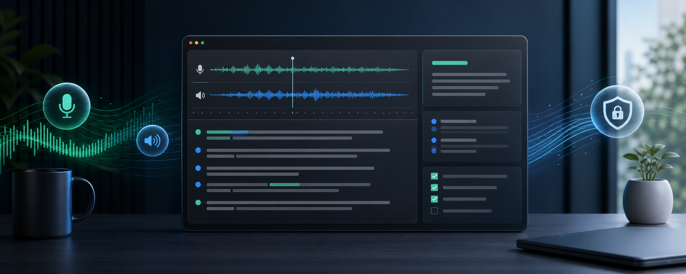

# ClawScribe



ClawScribe is a local-first Windows desktop companion for meetings, calls,
interviews, and recorded audio. It captures microphone and system audio from
your own session, transcribes speech locally, and turns transcripts into
reviewable meeting notes and action items. No meeting bot is required.

**0.64.1** is a Windows GPU preview. It fixes recording device selection,
Stop feedback, citation navigation, and saved-note editing. See the
[0.64.1 preview notes](docs/releases/0.64.1.md) and the
[latest stable release](https://github.com/ch3573r/ClawScribe/releases/latest).
Stable is **0.5.58**, published on 2026-11-15 without installed acceptance. Enable
**Include prereleases** to discover later previews; drafts are excluded from
updates.

ClawScribe is based on Meetily Community Edition **0.4.0**. Attribution and
license details are in [UPSTREAM.md](UPSTREAM.md), [NOTICE.md](NOTICE.md),
and [LICENSE.md](LICENSE.md).

## Install And Start A Meeting

Use the NSIS setup installer from the selected GitHub Release; an MSI is also
provided for deployment scenarios. Read that release's validation and signing
notes before installing. Draft builds are unpublished, and prereleases do not
advance the stable automatic-update channel.

The Windows GPU build needs the Vulkan loader (`vulkan-1.dll`) at startup, even
when selecting a non-Vulkan model. Use a supported GPU driver or the official
Vulkan runtime. The CI runtime fix does not install a driver or runtime on your
PC. See [Windows runtime prerequisites](docs/windows-release.md#windows-runtime-prerequisite)
for diagnosis; never download individual DLLs from third-party sites.

Choose a microphone and the output device used by Teams, Webex, or the other
meeting application. Make a short test recording and verify that both your
voice and the remote participants are audible in playback. Start recording,
review the live transcript, then stop and allow queued transcription to finish
before generating notes. You can also enable call detection for selected
meeting apps under **Settings → Recording → Call detection**.

**Test mic** in Recording settings shows the microphone actually tested. If a
preferred Windows microphone is unavailable, the test identifies its fallback
to the current default. A system-audio silence warning clears when sound later
arrives. A separate warning appears if microphone samples stop arriving for
15 seconds. Verify both sources in saved playback before relying on the recording.
During Stop, the window shows what is being saved. Choose **Start after saving**
to request the next recording once the previous one is in the library.

Review names, numbers, decisions, owners, and deadlines before sharing notes or
exporting tasks. Obtain the recording permissions required for your meeting.

## Command-line control

While ClawScribe is running, launch it again with a flag to control the running
instance from a Stream Deck, AutoHotkey, or a script:

- `--toggle-recording` starts recording, or stops it if one is running.
- `--start-recording` starts recording unless one is already running.
- `--stop-recording` stops the current recording if there is one.

Example: `"C:\Path\To\ClawScribe.exe" --toggle-recording`. The flags only work
on an instance that is already running; launching the app with a flag does not
start a recording. A start from the command line, the tray or a global shortcut
runs in the background: the window keeps its page and any unsaved text, and it
is not brought to the front. See
[Recording from the tray, shortcuts and command line](docs/tray-and-recording-control.md).

## Capture And Transcription

- Microphone and system-audio capture from the local Windows session.
- Live transcription, audio/video import, and retranscription with a different
  model or language selection.
- **Record now, transcribe later:** choose **Record audio now** on first launch
  to open Home in audio-only mode without a model download. Audio-only mode
  always saves audio and leaves a **Transcribe** action on the saved meeting.
  Live transcription and the local notes model can be set up independently.
  If a speech model fails after capture opens, a session with audio saving
  enabled continues in audio-only mode.
- **Check recording readiness:** Home shows the microphone, system output, and
  on-device live engine. **Recheck devices** refreshes the list after a change.
  Any hosted file-transcription preference is shown separately.
- Recording continues after temporary queue pressure or spool-write failures,
  with incomplete audio reported visibly. Playback streams saved recordings.
  Stop saves available audio even if transcript backup writes fail, and capture
  gaps are reported even after a source reconnects. Retry a missing source
  without interrupting the other source. Stop saves one library meeting and
  leaves the recording available in **Interrupted recordings** if the library
  write fails. Recovery originals use about 700 MB per hour while recording. Choose a local
  folder with enough space. See [recording and recovery](docs/meeting-quality.md).
- On Windows, a sleep notification asks ClawScribe to save the current recording.
  Sign-out and shutdown use the recording recovery files if Windows closes the
  app before it can finish. See [Windows sleep and sign-out](docs/tray-and-recording-control.md#windows-sleep-sign-out-and-shutdown).
- Correct transcript passages or preview literal find-and-replace across the
  entire meeting. Original recognition and segment timing are retained; undo
  restores previous corrections. Regenerate notes after correcting a transcript.
- **Restore previous transcript** after retranscription or speaker detection.
- Detect speakers in a saved recording and cancel from the dialog or meeting
  toolbar. Cancellation waits for the current native step before another recording
  can start.
- Import support for MP4, M4A, WAV, MP3, FLAC, OGG, AAC, MKV, WebM, and WMA.
- Select several files and review them one at a time. For each file, choose the
  meeting date, use the file's modified time, or keep the import time. You can
  also ask Built-in AI to generate notes after transcription.
- HE-AAC imports use the decoder's actual sample rate to preserve timing.
- Interrupted Whisper and Parakeet downloads retain partial files for retry;
  cancellation finishes the active transfer before another attempt can start.
- Disk-backed live recognition queue and interrupted-recording recovery paths.
- Timestamp playback controls, speaker-label editing, and a **Jump to live
  transcript** control when reading earlier text during a recording.

| Engine | Role |
| --- | --- |
| Parakeet | Default local fast path, with stock v3 int8, Parakeet Ultra (fine-tuned v3, int8 or fp16), SmoothQuant int8, and v2 int8 options. Supported GPU builds can use DirectML. |
| Whisper | Local whisper.cpp/whisper-rs engine with selectable models and Vulkan support in the Windows GPU build. |
| Nemotron | Beta multilingual Nemotron 3.5 ASR path. fp16 is CPU-capable; int8 is intended for DirectML-capable builds. |
| Hosted Whisper | Import and Enhance only (beta), through an opt-in OpenAI-compatible file-transcription API. |
| MAI-Transcribe | Import and Enhance only (beta), through opt-in Azure Speech Fast Transcription; credentials are separate from Microsoft Graph sign-in. |

**Run transcription in a separate process (beta).** With this switch on in the beta
settings, Parakeet loads and transcribes in a separate process. If the speech
model crashes or stops responding, ClawScribe restarts it and retries that
segment once, so the recording keeps running. After a failure with GPU
acceleration on, the rest of the session uses the CPU and the settings page says
so. The switch is off by default and applies to Parakeet only; Whisper and
Nemotron run inside the app as before.

Speech, speaker-detection, and Built-in AI summary models downloaded in the app
are pinned to specific revisions and SHA-256-verified before use. Damaged or
incomplete files require re-download; unchanged verified files reuse their
integrity checks.

In **Settings → Transcription**, **Browse engines** shows the available models.
Choose **Use** to switch to an installed model. **Test this PC** times the selected
Whisper, Parakeet or Nemotron model on two built-in speech samples in German and English.
The result shows the model, runtime backend, and processing time for each
sample. When two or more installed models of an engine recognized both samples
on the same backend, the fastest measured variant is marked. If the model falls
behind, you can switch to **Record now, transcribe later**. The test runs locally
and leaves the microphone free.

Whisper preserves recognized repetitions and short answers instead of removing
them through phrase matching. Nemotron's **Auto** language follows the system
locale; select the spoken language explicitly when it differs. Parakeet's Auto
selection does not label an unknown language as English.

In **Auto** language mode, the live transcript can show a separate language for
the microphone and system audio. Whisper uses confirmed languages to help with
short replies and continues checking longer turns for language switches.
Multilingual Parakeet estimates the languages from finalized text. When
the two sources overlap, ClawScribe keeps the transcript and leaves each
source's language unchanged. See [live transcript behavior](docs/meeting-quality.md#live-transcript-behavior).

**Settings → Transcription → Custom vocabulary** stores up to 500 names or
terms (64 characters each) and corrects similar spellings in new recordings,
imports, and retranscription. A recording uses the list loaded when its live
transcription starts. Matching supports Unicode names and terms, including
German umlauts and ß. Short terms require an exact match apart from case and
punctuation; single-letter keys such as C# and C++ are left unchanged.

Cloud transcription requires explicit opt-in. Saved cloud settings remain visible
when the opt-in is off. Settings explain which local engine and model live
recordings use. Cloud APIs apply to Import and Enhance (whole-file), while live
recordings stay on-device.
Hosted Whisper can provide word timestamps; MAI has sentence-level timing and
may use approximate local VAD-row alignment, not fabricated word timestamps.
The implemented OpenAI-hosted upload limit is 25 MB; the implemented MAI limit
is 300 MB. MAI uploads use WAV, MP3, or
FLAC, with other formats converted locally to 16 kHz mono WAV. Rejected cloud
requests can fall back to local transcription with a notification explaining
why. See [hosted transcription verification](docs/hosted-transcription-smoke.md).

## Meeting Notes And Exports

Search saved meeting titles and transcript passages from the sidebar or
**Meetings → Archive**. Archive search supports project and date filters and
opens passage matches at their verified transcript position, including later
pages. Return to Archive to keep the current search and filters.

The meeting-memory preview in this source branch adds **Meetings → Meeting
memory** in a separate tab: use the searchable picker to select saved meetings
explicitly, or choose all saved meetings, then
search transcript passages and ask cited questions. Project Any/All/Untagged
filters and inclusive dates constrain that same selection. Keyword retrieval
works without downloading a model; optional local semantic retrieval uses the
embedding model under **Settings → Meeting memory**. Installed files are
verified when first needed after startup or enabling semantic search. Results show the mode
actually used, and answers show the configured and executed summary provider.
The first question starts a saved conversation automatically. Conversations
restore their last submitted meeting scope, and answers can be copied. Model settings
show download bytes and integrity verification separately from indexing. The
pinned multilingual E5 model and tokenizer use ONNX Runtime locally on CPU;
healthy files can be verified without downloading them again.
Open citations to inspect evidence, reveal its current transcript position, or
play saved audio at a verified recording offset. Historical, changed, missing,
and invalid sources remain explicitly identified and cannot navigate as current
evidence. Existing meeting chat is preserved and defaults to this meeting only.
Expanding to other meetings uses a separate saved library conversation; switching
back restores the meeting's history.
Saved meetings also accept PDF, DOCX, TXT and Markdown reference documents.
Use **Attach file** directly in **Meetings → Meeting memory**; a single selected
meeting is the destination, otherwise choose a saved meeting there. The compact
corner chat on a meeting's details has a paperclip beside the question field.
Its **Context** control holds the meeting picker, project filters, and reference
files; selected files appear as removable chips above the question. **Search mode**
is in **More options**. Attach and preview files locally, then explicitly select which references a
question may use. Citations open the extracted page or paragraph, keeping
reference material distinct from the recorded discussion. Sending excerpts to
an external answer provider requires **Use selected references for answers** for that
conversation, off by default.

Source also includes a collapsible **Live assistance** panel above the Home
transcript. Explicitly choose **Ask**, **Summarize the last 10 minutes**, or **List open
questions** using the configured summary provider; no provider request runs
automatically. **Share live transcript with the provider** is off by default
and remembered for future recordings. Switch it on in Memory settings; the panel
shows during a recording only while it is on.
Selected saved meetings can supplement the current recording. Document selection
is explicit, and document sharing is independent and resets for each recording.
The panel and each answer show finalized-through time and incomplete status;
recent speech may still be catching up. Context is a fixed window of up to ten
minutes of finalized speech, ending at the finalized-through time. It is shorter
early in a recording or when the segment or size limit applies, and the answer
says so.
Cancel abandons assistance without waiting for the provider. Stop immediately
clears temporary Live messages; navigation preserves the current request without
starting another listener. Audio-only recordings and Built-in AI offer saved
meeting/transcription guidance instead of live generation. Ollama may compete
for this PC's resources; concurrent recording performance remains unmeasured.

Installed offline, provider-failure, focus, citation,
and playback acceptance remains pending; see the
[local library guide](docs/local-library.md#meeting-memory) and
[preview acceptance policy](docs/windows-release.md#required-real-device-acceptance).
Exact-build dual-source recording and comparable two-hour enabled/disabled
Live performance acceptance remain pending. Stable **0.5.58** was published
without these checks.

- **Local Word export:** save a summary, full transcript, or both as `.docx`,
  including tables, with optional speaker labels and recording-relative timestamps. Works offline without Microsoft
  sign-in or Word installed.
- **Project tags:** choose existing labels from a searchable list or create new
  ones, then filter the archive and transcript search by one or more projects
  (matching any or all), or show untagged meetings.
- **Meeting bookmarks and notes:** mark a moment from the recording bar, tray, or
  keyboard. Add timestamped notes while recording or during playback, then revisit
  them in the saved transcript. Choose whether to include them in meeting summaries.

Generate template-based meeting summaries from the transcript and optional
context, regenerate notes, and chat about the selected meeting. Per-meeting summary
context is saved in the local library and included in backups. Configurable
providers include Built-in AI, Ollama, OpenAI, OpenAI-compatible endpoints,
OpenRouter, Anthropic/Claude, Groq, OpenClaw managed processing, and the advanced
bundled Codex app-server path, plus **Claude Code** using your own installation.

Enable **Summarize automatically** in Summary settings to generate local notes
with Built-in AI or loopback Ollama after saving a recording. External providers
with a known destination require a review in Summary settings. A changed provider,
model, or destination requires fresh approval. For audio imports, you can review
and use the selected provider for that file. Reopen the meeting to check progress,
see why notes were skipped, or recover excerpt notes after a failed attempt.
Windows notifications can tell you when automatic notes are ready. See
[Automatic notes](docs/automatic-notes.md) for supported providers and recovery.

**Claude Code**: Uses the Claude Code you installed and signed in to. Your Claude
plan's limits apply. Install it yourself, run `claude auth login` in a terminal,
then select **Claude Code** in Summary settings. ClawScribe does not install
Claude Code or handle its sign-in or credentials. It supports text summaries and
meeting chat with tools disabled; choose Sonnet (default), Opus, or Haiku. These
models use the Claude API provider's context budgets. Prompts travel through stdin
and a temporary UTF-8 system file, keeping prompt text off the command line.
See [Claude Code setup and limitations](docs/auth/claude-code.md), including
Windows command shims and the optional Program path setting.

The advanced Codex provider bundles app-server **0.169.0**, with GPT-6.1 Sol
(`gpt-6.1-sol`) in its model catalog. Choose **Check bundled runtime** in Summary
settings after upgrading to refresh models. Availability depends on the signed-in account and workspace;
your saved model selection is preserved. OpenAI's API model fallback list also
includes GPT-6.1 Sol.

In **Settings → Summary**, create or edit templates and choose a persistent
default. Each meeting can use a different template when generating notes.
Summary find-and-replace preserves formatting and source links; review the
changes, which save automatically. Use the editor's undo command to revert changes.

Meeting titles and summary edits save automatically. Regenerating edited notes
asks for confirmation, and **Restore previous summary** lets you return to the
previous version after a successful generation. Newly generated notes show the
model and template used, and flag later changes to the saved transcript. When
the provider produces a follow-up email, open **Follow-up email** to read or
copy the draft.

Saving a title leaves unchanged notes alone. Failed saves retain drafts, and
edits made during a save remain available to save again. Switching meetings
discards late loading results from the previous meeting.

New summaries request links to supporting transcript passages. Open a source
link to inspect the text, reveal it in the transcript, or play its saved audio.
Changed or replaced passages are flagged and require regenerated references.
Citation coverage depends on the model; inspect the passage to check the claim.

Open **Meeting actions** from a saved meeting to review suggestions from the
summary or add follow-ups manually. Saved actions keep their owner, due date,
completion status, and any available source reference. This works offline.

**Settings → Calendars** lets you import an `.ics` file or add a read-only
subscription from a calendar provider. Upcoming meetings appear on Home, and
the sidebar shows the next one. Choose **Use for next recording** or let
ClawScribe link a single timed event in progress. For early joins, choose an event
starting in the next five minutes. Review attendance while
recording or from the saved meeting. Summaries receive only calendar names you
confirm. In a saved recurring meeting, open **Attendance** to choose a summary
template for the series. This works with Microsoft 365 and iCalendar. iCalendar
works without a Microsoft account. See [Calendar sources and attendance](docs/integrations/icalendar.md).

Microsoft sign-in supports calendar context and exports. Windows call detection
can prompt or start recording for the Teams, Zoom, Webex and Google Meet
providers you enable. Optional automatic stop applies to the recording started
for that call after the detector observes its end. Existing Teams preferences
remain Teams-only until you select other providers.
See [call detection](docs/teams-detection.md).

- **OneNote:** export notes or transcripts into a new section or resume in the
  saved section ID. Both paths work without listing sections.
- **Planner and Microsoft To Do:** review and edit action items before exporting;
  saved export history protects supported re-export paths against duplicates.
- **Confluence:** copy rich text into a browser draft, or publish through a
  configured self-hosted Server/Data Center REST endpoint.
- **OpenClaw:** optional handoff of completed Meetily-compatible recording folders.

**Export history** shows Microsoft export results from the meeting and travels
with portable backups. Microsoft exports stop if duplicate-protection history
cannot be read or saved.
An interrupted export with an unknown outcome is not automatically repeated;
check the destination before creating another page or task. See
[Microsoft export recovery](docs/integrations/microsoft-graph.md#export-history-and-recovery).

Private-network HTTP for OpenClaw, custom OpenAI endpoints, and Confluence requires
an explicit unencrypted-HTTP opt-in in Settings. Existing private HTTP setups
retain access on upgrade. Tailscale addresses and MagicDNS names are supported.
Public HTTP destinations are rejected on save/send; existing settings remain
editable and explain what needs correction. Confluence remembers its HTTP choice
for the saved server even while that server is offline.

OpenClaw is optional. A standalone installation does not require an OpenClaw
endpoint, token, or separate server.

## Library And Data

**Meetings → Archive** shows recording source and measured duration when available.
Filter to meetings that need attention to find incomplete recordings, missing
transcripts, and failed summaries. Use
**Storage** to measure the library or select meetings to review which saved
audio copies can be removed while keeping their transcripts and notes.
See [Archive review and storage](docs/local-library.md#archive-review-and-storage).

**Settings → Assistant access** lets an MCP client read the
saved meeting library. Enable the switch, copy the configuration, and add it
to your assistant. It can search meetings, read their notes and transcripts,
and locate saved recordings. The connection uses local standard input and
output. Access is off by default. See [local assistant access](docs/local-library.md#local-assistant-access).

**Backup and restore** saves a portable archive of meeting data, summary context,
and recordings. Restore adds missing meetings and skips existing IDs. Backups
continue when recording folders are missing and report affected meetings,
excluded recovery files, and unavailable audio. Archives exclude credentials and
models and are not encrypted.
Saved knowledge conversations, attached reference originals and extracted blocks,
and their original citation labels are included. Reference sharing permissions
are excluded and remain off after restore.
Restored references remain historical until a new question establishes fresh
evidence; interrupted answers are never resubmitted automatically.

Meeting deletion can also remove its recording folder, including audio,
transcript copies, metadata, recovery originals, and generated documents. The
option is on by default; folders outside supported storage locations, shared
with another meeting, or failing ownership checks are kept and reported.
Pre-migration database snapshots and separate backup archives can retain deleted
meetings. See [local library tools](docs/local-library.md#deleting-meetings).

## Update Preferences

ClawScribe checks **stable releases** by default. Enable **Include prereleases**
under **Settings > General > Updates** or **About** to receive preview builds
as well. The choice persists across restarts and applies to manual and startup
checks. You still choose when to install; checking at launch is a separate option.

Preview builds may contain unfinished features. Turning previews off waits for a
newer stable version and never downgrades your installation. Update downloads
retain Tauri signature verification and remain subject to Windows security policy.

## What changed in the 0.64.0 preview

- Start recording without downloading a speech model. Stop saves the meeting
  before reporting success, and interrupted saves can be recovered.
- Find a passage from the sidebar or Archive, jump to its audio, and bookmark
  moments for review. Sharing those notes with a summary is optional.
- Confirm who attended, remember a recurring meeting’s summary template, and
  edit follow-up tasks before exporting them to Planner or Microsoft To Do.
- Review meetings that need attention and see how much space saved audio uses
  before choosing which copies to remove.

See the [0.64.0 preview notes](docs/releases/0.64.0.md) for the updater behavior,
automated coverage, and pending device tests.

## What changed in the 0.63.0 preview

- A device reconnect no longer blocks the app, and a failed Stop is shown.
- A recording does not start on a nearly full disk, and a notice appears when
  space runs low.
- Home shows real levels for the microphone and the meeting audio.
- Recovery also finds interrupted recordings in the recording folders.
- Stored keys stay in the core and are only sent to the address they were saved
  for. Files and folders are used when you chose them in a dialog.
- Engine, cloud and language settings are stored by the core.

See the [preview notes](docs/releases/0.63.0.md) for limits and pending
real-device checks.

## What changed in the 0.62.0 preview

- A manually started recording uses the title and the devices you chose.
- Starting a recording stops a running retranscription, import, speaker
  detection or PC test instead of failing.
- Stop in the sidebar works from every page, and a stop no longer pulls you to
  the new meeting unless Home is open.
- Quit during a recording saves the meeting first. A capture failure is shown.
- Notices follow the theme and appear at the bottom right.
- Settings → Transcription has a language setting. Settings → Appearance has
  more fonts, a separate transcript and summary font, and a text size setting.
- Translated summaries keep English working terms.

See the [preview notes](docs/releases/0.62.0.md) for limits and pending
real-device checks.

## What changed in the 0.61.1 preview

- With live transcription, audio capture starts while the speech model loads. The
  first seconds after pressing Record are no longer lost.
- Quiet speech is raised to a normal level before Parakeet transcribes it, in live
  recording, retranscription and import.

See the [preview notes](docs/releases/0.61.1.md) for a known issue and pending
real-device checks.

## What changed in the 0.61.0 preview

- Settings has one page per topic. Add-ons is split into Microsoft 365, Calendars,
  Confluence and Assistant access. The Beta switches are on the Transcription page.
- **Settings → Privacy** lists what stays on this PC and what leaves it, based on
  your current settings.
- Call detection is under **Settings → Recording**, with a live microphone level.
  It recognises Teams calls whose controls read Leave and Mute mic.
- Parakeet models are listed in a table that keeps the measured speed per model.
- Summary settings save as you change them. A different provider is used only
  after you choose **Use**.
- The sidebar shows the next calendar event and groups meetings by date.
- Calendar files and subscriptions can be up to 16 MiB.

See the [preview notes](docs/releases/0.61.0.md) for pending real-device checks.

## What changed in the 0.5.60 preview

- Import an iCalendar file or add a read-only subscription in **Settings → Add-ons**.
  Choose an upcoming event to prefill the next recording title and review invitees.
- Enable call detection for Teams, Zoom, Webex or Google Meet. Automatic stop can
  finish the recording that the detector started when the call ends.
- See language estimates for the microphone and system audio when source
  attribution is enabled. **Test this PC** times an installed speech model.
- Connect an MCP client to the local meeting library with read-only access.
  The Live assistance panel appears when live transcript sharing is enabled.

See the [preview notes](docs/releases/0.5.60.md) for updater settings and pending
real-device checks.

## What changed in 0.5.59 preview

- Speaker detection uses a different voice model and grouping threshold. On a test
  set of four-person meetings it found 3 to 9 speakers where the previous default
  found 10 to 114. The model (about 40 MB) downloads on the next detection.
- Detect speakers no longer needs the Beta source attribution setting, and speaker
  labels show whenever a meeting has them.
- Relabeling is two actions: "Who said this?" on a transcript row, and renaming or
  merging a speaker from the timeline.
- Summary citations point at a passage of at most 10 seconds, not 45.
- Action items are a list with owner and due date that Planner and To Do export can
  read. Unanswered questions get their own Open questions section.
- The playback strip and the active transcript row follow the accent colour.
- Check these on an installed build with real meeting audio. These checks remain
  pending before stable promotion.

See the [preview notes](docs/releases/0.5.59.md) and the [changelog](CHANGELOG.md).

## What changed in 0.5.58

- Meeting details has the title in a header across the page, a playback strip that
  shows the transcript segments, and one-row toolbars with menus for the less
  common actions.
- The summary renders on the pane surface with section labels on their own line.
  Chat opens from a button under the summary and docks beside it in wide windows.
- The Meetings list, its empty states and Meeting memory are simpler to scan.
- Add-ons has one Microsoft 365 card and a Change folder dialog for OneDrive.
  Microsoft product icons use their own colours.
- Claude Code is an optional summary and meeting chat provider that uses your own
  installed and signed-in Claude Code.
- Error messages are app notifications, not browser alerts. Error text in the dark
  theme and keyboard focus rings are easier to see.
- These changes were published to stable without installed acceptance. Installed
  checks in light and dark themes and recording acceptance remain open.

See the [release notes](docs/releases/0.5.58.md), the
[previous transcription preview](docs/releases/0.5.57.md), and the [changelog](CHANGELOG.md).

## Notebook Performance And Product Status

Windows is the primary release target; the supported runtime is the Tauri
desktop app. macOS/Linux source paths are not a claim of equivalent release
validation. Nemotron and cloud transcription remain beta.

On Windows, Whisper's adaptive policy caps inference at four threads when the
detected memory value is at most 8 GiB, and at eight otherwise. Where possible
it leaves one logical thread outside that limit. This is a Whisper policy,
not a process-wide CPU or RAM cap, and does not automatically govern Parakeet,
Nemotron, or a summary provider. A valid `MEMORY_GB` environment override is
retained for diagnostics.

Performance depends on the selected model, audio, available memory, GPU/driver,
and the concurrent meeting application. The i5-1235U/8 GB target has not been
certified by the source tests. Do not interpret queued transcription as lost
audio or claim it is live when processing is still catching up.

## Privacy And Credentials

Recording and transcription remain local unless you explicitly enable cloud
transcription or configure external summary/export processing. Data sent to an
external provider is subject to that provider's configuration and policies.

Provider keys, OpenClaw, and Microsoft refresh tokens use protected OS storage,
with current-user DPAPI fallbacks on Windows. Codex sign-in and Confluence use
the keyring without file fallback. Meeting files and the full database are not
encrypted by this protection; see the [privacy policy](PRIVACY_POLICY.md).

Never commit credentials, `.env` files, private logs, recordings, databases,
generated installers, or personal workspace paths. Use explicit placeholders
in examples and keep diagnostics redacted. Contributor guidance is in
[CLAUDE.md](CLAUDE.md) and [CONTRIBUTING.md](CONTRIBUTING.md).

## Development

Use Node.js 24, pnpm 10, and the native prerequisites in
[Building ClawScribe](docs/BUILDING.md). From `frontend/`:

```powershell
pnpm install --frozen-lockfile
pnpm run tauri:dev
```

For the web UI only, use `pnpm run dev`. It is not a replacement for native
recording tests. Run frontend checks with `pnpm typecheck` and `pnpm test`.
Windows packaging and required sidecar staging are documented in
[Windows releases](docs/windows-release.md).

All CI checks and Windows installers run on the designated local self-hosted
machine, with no GitHub-hosted fallback. Fork PRs require maintainer review and
validation from a trusted repository branch. Test installers and build caches
stay local; GitHub distribution uses explicitly requested draft or published
releases.

```text
frontend/src/             React UI, hooks, services, and routes
frontend/src-tauri/src/   Rust/Tauri audio, transcription, summary, and exports
llama-helper/             Local summary sidecar
scripts/                  Repository utilities
docs/                     Product and build documentation
```

The historical Python/FastAPI service has been removed; no standalone service,
Docker component, or manually started whisper-server is needed for local use.

## Documentation And Support

In **Settings → Diagnostics**, choose **Save report** to save a JSON file for
troubleshooting. It contains app and platform information, device counts,
engine status, and failure categories. You choose where to save it and whether
to share it. See the [diagnostics report contents](docs/architecture.md#diagnostics-report).

- [Documentation index](docs/README.md)
- [Building from source](docs/BUILDING.md)
- [Windows release and verification](docs/windows-release.md)
- [GPU acceleration](docs/GPU_ACCELERATION.md)
- [Frontend developer guide](frontend/README.md)

[Support development](https://buymeacoffee.com/ch3573r).

## License

ClawScribe is free to use, modify, and redistribute under the
[MIT License](LICENSE.md). Upstream Meetily code is copyright Zackriya Solutions
and contributors. ClawScribe changes are copyright OpenClaw contributors unless
otherwise noted.
